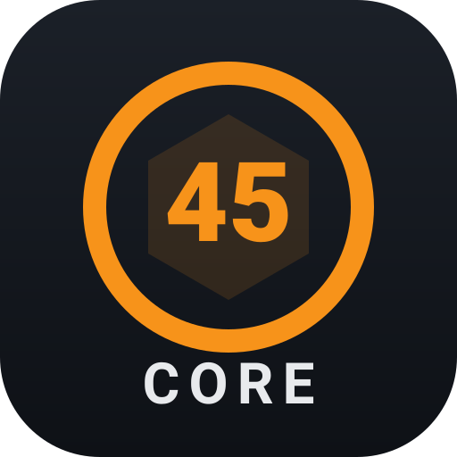
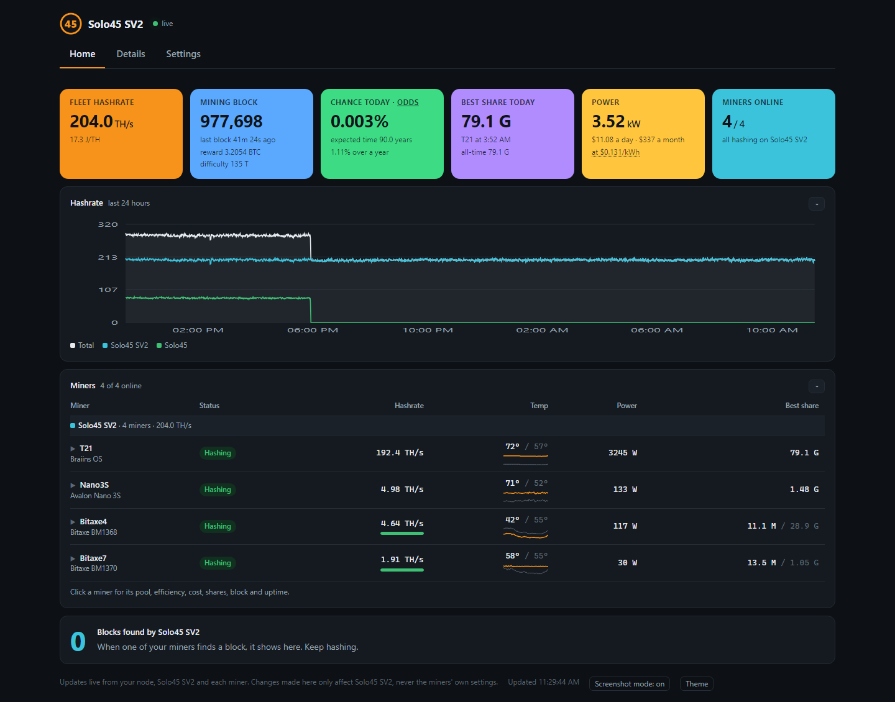
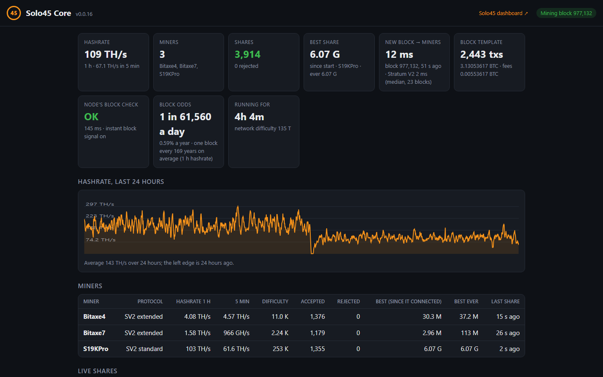
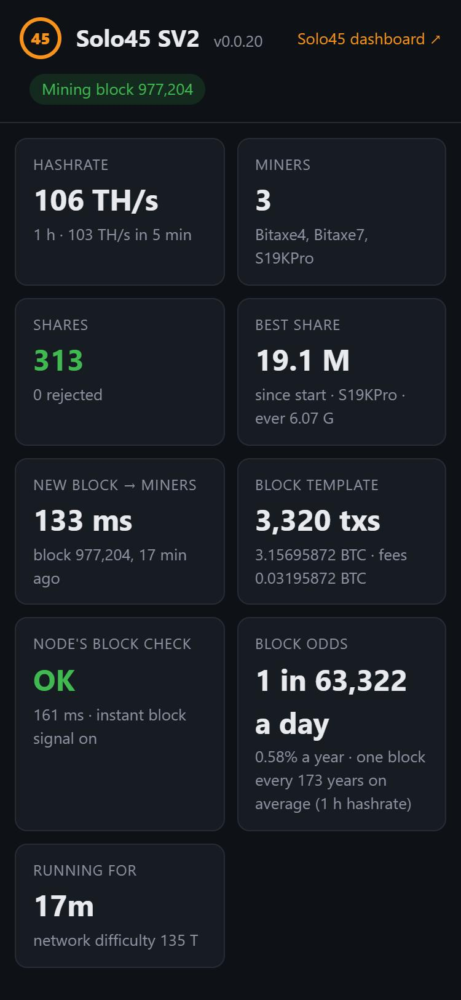

<p align="center"></p>

# Solo45 SV2

**A fast solo Bitcoin mining pool in Rust, for your own node.** Test version.

Solo45 SV2 is a separate app from [Solo45](https://github.com/race45race/solo45): the same solo pool rewritten in Rust,
with Stratum V2 (it was called Solo45 Core until 0.0.18; the repository and image keep that name). It builds work
from your own Bitcoin node, puts your address in the coinbase and pays any block you find straight to you, with
no pool fee. It runs next to the Solo45 app, on its own port, so you can move miners over one at a time.

- **Same work as Solo45, byte for byte.** Jobs, coinbase, merkle branches and found blocks are cross-checked
  against Solo45's pool.
- **Fast block switching.** New blocks arrive by ZMQ the moment your node has them; miners get an empty job for
  the new height within a few milliseconds, then the full template.
- **Every job checked by your node** (`getblocktemplate` proposal mode).
- **Safe block submission.** A found block is saved to disk first, then sent, and resent for up to 10 minutes
  while the node is down or still starting (a node restart can take minutes). The node's own answer ends it. If Core itself stops while sending one, it
  sends it again when it starts, as long as the block can still count.
- **Steady share difficulty.** Vardiff per miner, remembered across restarts, or a fixed difficulty or share rate
  per miner.
- **Template policy.** Leave out inscriptions, Runes, large OP_RETURN data, bare multisig or low fee rates (judged
  by package, child pays for parent, like the node). Each rule can be Off, Watch (only count) or Filter; a filtered
  job that ever fails the node's check falls back to the node's own template for that block. Same results as
  Solo45's policy, transaction for transaction.
- **Stall guard.** If a peer announces a block but never sends it, Core disconnects that peer after 60 s
  (adjustable), instead of your miners hashing on an old block for 10 minutes.
- **Backup and restore** of the payout address, settings, per-miner difficulty and policy (also reads a Solo45
  dashboard backup).
- **Stratum V2** (encrypted, on its own port), built on the Stratum V2 reference implementation's crates: Noise
  handshake with this pool's authority key, standard channels (header-only mining: Braiins OS, AxeOS "standard")
  and extended channels (AxeOS "extended", the reference Translator Proxy), the reference share checks and vardiff.
  Same work, payout and block checks as the V1 port; found blocks take the same save-first path. Tested end to end
  on a private regtest chain (blocks with segwit transactions accepted by the node, over both channel types) and on
  mainnet templates. `solo45-core sv2-miner <host:port> <authority key> <user> <shares>` is a small CPU test miner
  for standard channels.
- **The full Solo45 dashboard (Umbrel app):** the app also runs its own copy of the
  [Solo45](https://github.com/race45race/solo45) dashboard, named Solo45 SV2 and reading only this pool: Home,
  Details and Settings tabs with fleet hashrate and odds, every miner's temperature, fan, watts and tuning, best shares
  and journeys, block timing, luck, network and node, phone alerts and backup. It needs nothing from the Solo45 app.
- **Built-in status page** (also without Umbrel): hashrate over 24 hours, live shares, each miner's best share ever, each miner's temperature, fan
  and watts (read every 30 s from Bitaxes over AxeOS and from Braiins OS and Canaan Avalon miners over port 4028; read only, no logins), the pool settings (job updates, always pay my address, empty block first, electricity price and power cost a day), each miner's share difficulty (automatic, seconds per share or fixed), a 24-hour chart per miner, the last 30 new blocks (work to V1 and SV2 miners, full template, node's check), block switch times (V1 and
  SV2), the node's block check, settings and backup/restore. `?screenshot` hides the payout address and miner IPs.
- **Small and fast.** One binary. Load test (tools/load_test.py) with 100 Stratum V1 and 20 Stratum V2 miners on
  mainnet templates for 12 minutes: 7,469 shares, 0.7% of one CPU core, 33-76 MB of memory, a new block's work to
  all 100 V1 miners in 1 ms and to all 20 SV2 channels in 2 ms.
- **Tested on every release:** GitHub runs the private regtest chain tests (real blocks over V1 and both kinds of
  SV2 channel, a block the node refuses, the stall guard) before a version reaches the app store.

Planned: job declaration, a proxy mode and public stats pages.

## Screenshots

The Solo45 SV2 dashboard, what opens from the Umbrel home screen (screenshot mode: payout address and miner IPs
hidden). Home: fleet hashrate, odds, best share, power and every miner:

<p align="center"></p>

[Details](docs/gallery/5-dashboard-details.png): live shares, best share by miner and the journey to beat it, luck,
tuning report, Avalon controls, block switch times.
[Settings](docs/gallery/6-dashboard-settings.png): pool settings, share difficulty per miner, the Stratum V2 key and
pool URL, template policy, phone alerts.

The pool's own built-in status page (for running without Umbrel):

<p align="center">
&nbsp;</p>

[The whole page](docs/gallery/2-full-page.png): live shares, payout, template policy, stall guard.

## Install on Umbrel

1. Add the community app store `https://github.com/race45race/solo45` in umbrelOS (App Store → ⋯ → Community App
   Stores) and install **Solo45 SV2**. It needs the **Bitcoin Node** app, fully synced.
2. Open Solo45 SV2 (its dashboard) and enter your **payout address** on the Settings tab. Your node checks it before it's saved.
3. Point a miner at **`stratum+tcp://<your Umbrel's IP>:3346`**. Keep a backup pool set on every miner.

Keep port 3346 on your home network: don't forward it to the internet.

**Optional, faster templates (IPC):** in the Bitcoin Node app, turn on **Settings → IPC Mining Interface** (Bitcoin
Core 32+, it restarts the node). Solo45 SV2 (app 0.0.32+) then takes its block templates over Bitcoin Core's IPC mining
interface: a new block's full work is ready in milliseconds instead of a `getblocktemplate` call, and routine
refreshes with thousands of transactions take ~20 ms. The app sees the node's folder read-only, only for the socket.
With the setting off nothing changes: it uses RPC as before, and it falls back to RPC by itself whenever IPC isn't
there. When the template policy filters (that needs each transaction's fee, which IPC doesn't give), templates come
from `getblocktemplate`.

## Run without Umbrel

```sh
docker run -d --name solo45-core -p 3346:3346 -v $PWD/data:/data \
  -e SOLO45_DATA_DIR=/data -e SOLO45_WEB_PORT=8346 \
  -e BITCOIN_RPC_URL=http://<node>:8332/ -e BITCOIN_RPC_USER=<user> -e BITCOIN_RPC_PASS=<pass> \
  -e BITCOIN_ZMQ_HASHBLOCK=tcp://<node>:28332 \
  ghcr.io/race45race/solo45-core:v0.0.32
```

For IPC templates, start Bitcoin Core 32+ as `bitcoin-node -ipcbind=unix` (or `bitcoin -m node -ipcbind=unix`), mount
its data directory into the container (read-only is enough) and set `SOLO45_IPC_SOCKET` to its `node.sock` (in the
network's subdirectory for testnet/signet/regtest). The container must run as the user that owns the socket.

The status page (port 8346) only answers the machine itself and the container's gateway; reach it through a
reverse proxy that checks a login, or an SSH tunnel.

## Settings

| Variable | Default | |
|---|---|---|
| `SOLO45_STRATUM_PORT` | 3346 | port for miners |
| `SOLO45_API_PORT` | 3386 | Solo45-compatible API (local or `X-Solo45-Token`) |
| `SOLO45_WEB_PORT` | 0 (off) | status page |
| `SOLO45_SV2_PORT` | 0 (off) | Stratum V2 port (the authority key is made on first start, in sv2-authority.json) |
| `SOLO45_WEB_READERS` | | addresses or container names (looked up every minute) that may read the status, share feed and history on the status page's port and set per-miner difficulty (the Solo45 dashboard) |
| `SOLO45_API_TOKEN` | | shared secret for the API |
| `SOLO45_DATA_DIR` | . | state.json, blocks_found.jsonl |
| `SOLO45_LOG_FILE` | stdout | log file, rotated at 20 MB |
| `BITCOIN_RPC_URL` | http://127.0.0.1:8332/ | |
| `BITCOIN_RPC_USER` / `_PASS` / `_COOKIE` | | node login (user/pass, or the cookie file) |
| `BITCOIN_ZMQ_HASHBLOCK` | | e.g. tcp://127.0.0.1:28332; without it Core polls every 100 ms |
| `SOLO45_DEFAULT_ADDRESS` | | payout address (or set it on the status page) |
| `SOLO45_SHARE_SECONDS` | 10 | vardiff target |
| `SOLO45_EMPTY_HOLD_S` | 10 | how long the empty job for a new block runs before the full template |
| `SOLO45_TEMPLATE_REFRESH_S` | 30 | new job with fresh transactions |
| `SOLO45_STALL_GUARD_S` | 60 | stall guard (0 = off; the status page setting wins) |
| `SOLO45_MINER_READINGS` | 1 | read temperature, fan and watts from connected miners on private addresses (0 = off) |
| `SOLO45_IPC_SOCKET` | | Bitcoin Core's IPC socket (`node.sock`, node started with `-ipcbind=unix`): templates over IPC, `getblocktemplate` as the fallback; status in the API's `pool.ipc`: `up`, `age_s` (newest template), `used` / `rpc_used` (jobs from IPC / from getblocktemplate), `fallback` (why getblocktemplate was used last), `skipped` + `last_skip` (templates from the node it couldn't use, and why) |

## API

Two HTTP listeners, both JSON.

**The API** (`SOLO45_API_PORT`, default 3386; not published by the Umbrel app) answers only the machine itself, or
a caller that sends the shared secret as `X-Solo45-Token` (`SOLO45_API_TOKEN`). It's compatible with Solo45's pool
API, so tools written for Solo45 work with Core.

**The status page** (`SOLO45_WEB_PORT`) serves the page and the same routes, but only to the machine itself and the
container's default gateway (umbrelOS's login-checking app gateway). Changes there also need a same-origin browser
request (`Sec-Fetch-Site: same-origin`, or an `Origin` matching `Host`). Addresses in `SOLO45_WEB_READERS` (the Solo45
dashboard) may only read `/api/state`, `/api/shares` and `/api/history`, and POST `/api/worker`.

| Route | | |
|---|---|---|
| `GET /api/state` | snapshot | `pool` (height, hashrate_1h / _5m in H/s, network_diff, accepted, rejected, best, last_switch, sv2_switch, timing, policy, …), `workers` (name, ip, agent, address, diff, hashrate, accepted, rejected, last_share, best_ever, override, device: temp, vr_temp, fan, watts), `sv2` (port, authority key), `version`, `uptime` |
| `GET /api/shares?since=N` | live share feed | shares with a sequence number above N (worker, diff, share difficulty, time) |
| `GET /api/history` | 24 h chart | `{"history": [[time, hashrate TH/s, miners], …]}`; `?worker=NAME`: that miner's `[[time, TH/s], …]` |
| `GET /api/export` | backup | settings, per-miner overrides, policy, last difficulties |
| `POST /api/worker` | per-miner difficulty | `{"name": "Bitaxe7", "diff": 2000}`, `{"name": …, "share_seconds": 10}`, or `{"name": …}` for automatic |
| `POST /api/settings` | pool settings | any of `template_refresh_s` (1-120), `stall_guard_s` (0 or 20-600), `empty_first`, `empty_hold_s` (1-40), `force_default_address`, `electricity_usd_kwh` (0-2, for the power cost) |
| `POST /api/payout` | payout address | `{"address": "bc1…"}`; your node checks it first |
| `POST /api/policy` | template policy | `{"mode": "off"\|"watch"\|"filter", "rules": {…}}` (see the page's Save policy) |
| `POST /api/restore` | load a backup | the `/api/export` JSON (or a Solo45 dashboard backup) |

Example from the machine Core runs on:

```sh
curl -s localhost:3386/api/state | jq '.pool.hashrate_1h, [.workers[].name]'
curl -s -X POST localhost:3386/api/worker -H 'Content-Type: application/json' -d '{"name":"Bitaxe7","share_seconds":10}'
```

## Build

```sh
cargo test --release && cargo build --release
```

Building needs the Cap'n Proto compiler and its standard schemas for the IPC client, e.g. on Debian/Ubuntu
`apt-get install capnproto libcapnp-dev`.

MIT license.
